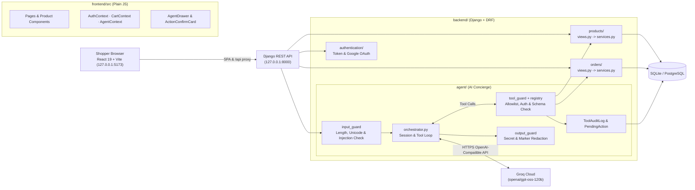
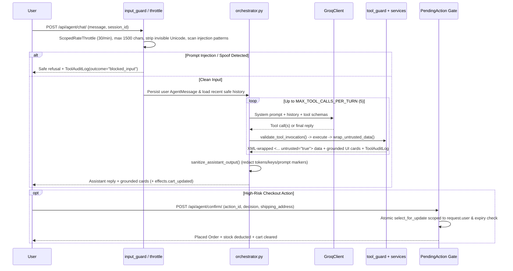

# Agentic Shop Engine

Full-stack e-commerce platform combining a **Django REST Framework** backend, a **React (JavaScript) + Vite** storefront, and a **Groq-powered Shopping Concierge** protected by multi-layer prompt-injection guardrails and human-in-the-loop checkout confirmation.

---

## Core Capabilities

- **Curated Storefront & Catalog Discovery**: Editorial storefront with category filtering, price bounds, sorting, and hybrid natural-language + metadata search (`products/services.py`).
- **Shopping Bag & Atomic Checkout**: Authenticated cart management, stock validation, shipping/tax calculation, atomic inventory deduction (`select_for_update`), and order history (`orders/services.py`).
- **Authentication & Google OAuth**: Email/password registration and token/session authentication alongside Google OAuth (`authentication/`).
- **AI Shopping Concierge (`agent/`)**: Multi-turn tool-calling assistant powered by Groq (`openai/gpt-oss-120b` with automatic fallback to `openai/gpt-oss-20b` and `qwen/qwen3.8-27b`) capable of searching products, checking stock/specs, inspecting or modifying the user's cart, viewing orders, and preparing checkout cards.
- **Defense-in-Depth Guardrails**: Input injection screening, strict tool schema & identity-binding enforcement, XML data-boundary isolation for catalog data, secret redaction on output, scoped rate throttling, and immutable audit logging.

---

## System Architecture



### Key Architectural Decisions

1. **Shared Domain Service Layer**: Business logic lives in [`backend/products/services.py`](backend/products/services.py) and [`backend/orders/services.py`](backend/orders/services.py) so both REST endpoints and agent tools execute the exact same validated pricing, stock, and transaction logic without duplication.
2. **Server-Bound Authorization**: The LLM never supplies or selects a user ID. User identity comes exclusively from Django's `request.user`. Unauthenticated users may run read-only catalog tools (`list_categories`, `search_products`, `get_product_detail`), while `get_cart`, `add_to_cart`, `remove_from_cart`, `get_order_history`, and `prepare_checkout` require authentication.
3. **Human-in-the-Loop Checkout Gate**: The concierge never places an order silently. `prepare_checkout` validates cart inventory via `preview_checkout()` and records a short-lived `PendingAction` (`15` minutes). Order placement (`execute_checkout`) executes only when the authenticated owner explicitly submits `POST /api/agent/confirm/` from the UI's `ActionConfirmCard`.
4. **Grounded UI Cards**: Product cards, cart summaries, order confirmations, and checkout previews rendered inside `AgentDrawer` are populated directly from serialized database records returned by tool handlers rather than trusting free-form text generated by the LLM.

---

## AI Security Guardrail Pipeline



---

## Repository Structure

```text
Agentic_Shop_Engine/
├── .gitignore
├── readme.md
├── run.py                                  # Unified dev runner for Django + Vite
├── backend/
│   ├── .env.example                        # Backend environment variable template
│   ├── manage.py
│   ├── requirements.txt
│   ├── readme.md                           # Backend-specific API & setup notes
│   ├── backend_config/
│   │   ├── settings.py                     # DRF, Token/Session auth, allauth, throttles, Groq config
│   │   └── urls.py                         # Routes /admin/, /api/auth/, /api/products/, /api/orders/, /api/agent/
│   ├── authentication/                     # Custom User model, registration, login/logout, Google OAuth
│   ├── products/
│   │   ├── models.py                       # Category, Product
│   │   ├── services.py                     # Hybrid natural-language + metadata search & catalog helpers
│   │   ├── views.py                        # REST endpoints delegating to products/services.py
│   │   └── management/commands/seed_catalog.py
│   ├── orders/
│   │   ├── models.py                       # Cart, CartItem, Order, OrderItem
│   │   ├── services.py                     # Cart mutations, checkout preview, atomic checkout, order history
│   │   └── views.py                        # REST endpoints delegating to orders/services.py
│   └── agent/
│       ├── models.py                       # AgentSession, AgentMessage, PendingAction, ToolAuditLog
│       ├── prompts.py                      # Security & grounding system prompt builder
│       ├── llm_client.py                   # Groq Chat Completions client & fallback model chain
│       ├── orchestrator.py                 # Multi-turn loop & PendingAction confirmation processor
│       ├── serializers.py                  # Chat/confirm request & session-synced serializers
│       ├── views.py                        # /api/agent/chat/, /confirm/, /sessions/<uuid>/
│       ├── tests.py                        # Guardrail, auth, checkout confirmation & redaction tests
│       ├── guardrails/
│       │   ├── input_guard.py              # Length limit, Unicode sanitization, injection regex, XML wrapper
│       │   ├── tool_guard.py               # Allowlist, auth check, arg bounds, spoof-key blocking
│       │   ├── output_guard.py             # API key / secret / prompt-marker redaction
│       │   └── rate_limiter.py             # ScopedRateThrottle (agent_chat, agent_confirm)
│       └── tools/
│           ├── catalog_tools.py            # list_categories, search_products, get_product_detail
│           ├── cart_tools.py               # get_cart, add_to_cart, remove_from_cart
│           ├── order_tools.py              # get_order_history, prepare_checkout
│           └── registry.py                 # ToolSpec schemas & audited dispatch_tool()
└── frontend/
    ├── .env.example                        # Frontend environment variable template
    ├── index.html
    ├── package.json
    ├── vite.config.js                      # Proxies /api and /media to Django backend
    ├── public/images/products/             # Product SVG artwork
    └── src/
        ├── App.jsx                         # Router, context providers, Concierge launcher & drawers
        ├── api/                            # Fetch client, local preview fallback & module APIs (incl. agent.js)
        ├── context/                        # AuthContext, CartContext, AgentContext, ToastContext
        ├── components/
        │   ├── agent/                      # AgentDrawer.jsx, AgentMessage.jsx, ActionConfirmCard.jsx
        │   ├── auth/                       # GoogleLoginButton.jsx
        │   ├── cart/                       # CartDrawer.jsx
        │   ├── layout/                     # Navbar.jsx, Footer.jsx
        │   └── product/                    # HybridSearchBar.jsx, ProductCard.jsx, ProductImage.jsx
        ├── pages/                          # Home, Shop, ProductDetail, Cart, Checkout, Orders, Login, Signup, GoogleCallback
        ├── styles/                         # tokens.css, global.css
        ├── utils/                          # Currency & stock formatting helpers
        └── test/                           # Vitest + React Testing Library suite
```

---

## REST API Overview

| Domain | Method & Path | Access | Purpose |
| :--- | :--- | :--- | :--- |
| **Auth** | `POST /api/auth/register/` | Public | Create account & issue auth token |
| | `POST /api/auth/login/` | Public | Sign in & issue auth token |
| | `POST /api/auth/logout/` | Authenticated | Clear session/token |
| | `POST /api/auth/google/` | Public | Google OAuth login / account link |
| **Products** | `GET /api/products/` | Public | Paginated catalog with filters & sorting |
| | `GET /api/products/categories/` | Public | Categories with active product counts |
| | `GET /api/products/search/` | Public | Hybrid natural-language + price/stock search |
| | `GET /api/products/<id>/` | Public | Single product details & stock |
| **Orders** | `GET /api/orders/cart/` | Authenticated | View current user's cart |
| | `POST /api/orders/cart/add/` | Authenticated | Add/increment product in cart with stock validation |
| | `DELETE /api/orders/cart/remove/<item_id>/` | Authenticated | Remove line item from user's cart |
| | `POST /api/orders/checkout/` | Authenticated | Atomic checkout, stock deduction & order creation |
| | `GET /api/orders/history/` | Authenticated | Current user's past orders |
| **Agent** | `POST /api/agent/chat/` | Public (cart/order tools require auth) | Run guarded concierge turn (`session_id`, `message`) |
| | `POST /api/agent/confirm/` | Authenticated | Confirm or cancel a `PendingAction` checkout gate |
| | `GET /api/agent/sessions/<uuid:session_id>/` | Session owner / guest | Retrieve conversation history & synced card statuses |

---

## Tech Stack

- **Backend**: Python, Django `6.1.3`, Django REST Framework `3.18.3`, `django-allauth`, `dj-rest-auth`, `djangorestframework-simplejwt`, `python-decouple`, `psycopg2-binary`, `requests`, SQLite (default local) / PostgreSQL.
- **AI Provider**: Groq OpenAI-compatible Chat Completions API (`GROQ_API_KEY`, default `openai/gpt-oss-120b`).
- **Frontend**: React `19`, React Router `7`, Vite `6`, `lucide-react`, plain JavaScript (`.js`/`.jsx`) with CSS custom properties.
- **Testing**: Django `APIClient` / `TestCase`, Vitest `3`, React Testing Library, `jsdom`.

---

## Setup & Running Locally

### 1. Environment Variables

Copy `backend/.env.example` to `backend/.env` and set your keys:

```env
SECRET_KEY=your_django_secret_key
DEBUG=True
ALLOWED_HOSTS=localhost,127.0.0.1
DB_ENGINE=sqlite
DB_NAME=ecommerce_db
DB_USER=postgres
DB_PASSWORD=your_password
DB_HOST=localhost
DB_PORT=5432
GOOGLE_CLIENT_ID=your_google_oauth_client_id
GOOGLE_CLIENT_SECRET=your_google_oauth_client_secret
GROQ_API_KEY=your_groq_api_key
GROQ_MODEL=openai/gpt-oss-120b
```

Optionally copy `frontend/.env.example` to `frontend/.env` if customizing `VITE_API_BASE_URL` or `VITE_GOOGLE_CLIENT_ID`.

### 2. Backend Setup & Seed Catalog

```powershell
cd backend
python -m venv venv
.\venv\Scripts\activate
pip install -r requirements.txt
python manage.py migrate
python manage.py seed_catalog
```

*(Note: `requests` is installed alongside `django-allauth` in the virtual environment and is used by `GroqClient`.)*

### 3. Unified Development Runner (`run.py`)

From the repository root, launch both Django (`http://127.0.0.1:8000`) and React/Vite (`http://127.0.0.1:5173`):

```powershell
python run.py
```

Useful flags supported by `run.py`:
- `--migrate`: Run Django migrations before starting the backend server.
- `--install`: Install/refresh `frontend/node_modules` before starting Vite.
- `--open`: Automatically open the storefront in your default browser once ready.
- `--backend-only` / `--frontend-only`: Run a single service.
- `--backend-host`, `--backend-port`, `--frontend-host`, `--frontend-port`: Customize bind hosts and ports.

---

## Verification & Tests

Run backend unit & guardrail tests:

```powershell
cd backend
.\venv\Scripts\python.exe manage.py test -v 2
```

Run frontend component & integration tests + production bundle check:

```powershell
cd frontend
npm test
npm run build
```

